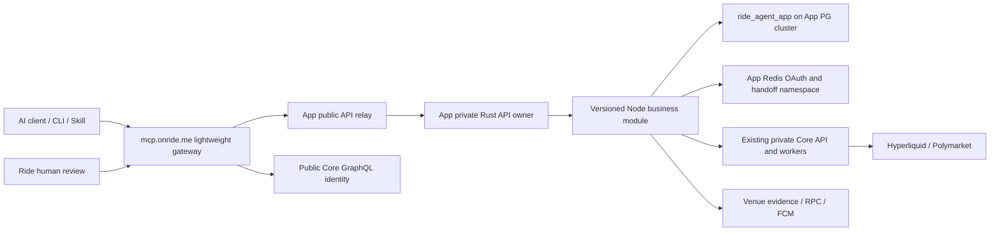

# Rider 系统架构

核对范围：Node 业务模块源码 `dd6dacd0159b8dd83c320b163d74864befc96fa0`，App 托管/流式 relay 源码 `4ffc2965575d9c23a2812f0f8425f990c16a7d62`。这里描述代码实现；生产切换核对时点、运行身份和观察边界见 [status](status.md)，不从合并或构建成功推定已切换。

## 托管部署的组件与边界

| 组件 | 入口和监听 | 信任职责 |
|---|---|---|
| MCP gateway | `src/server.ts`，公网 `mcp.onride.me` | OAuth issuer/resource、MCP、CLI 与 human 页面；通过 HTTP 调 App，不持有 Agent PG/Redis 连接配置 |
| App public relay | `predictly_server/crates/api/src/agent_app_runtime`，public API | 原样透传原用户 Bearer；不注入 Core 权限、不自动重试 POST；Tool/Human 响应随背压流式传输 |
| App private owner | 同 Rust API crate，private service `ae126414-21a9-4795-9a38-5fcd144fd4ea` | 显式 private/runtime/backend gates、监督一个版本化 Node 子进程、ready/STOPPING/EOF 生命周期 |
| Node backend / bridge / session RPC | App 冻结模块 → `src/app_runtime.ts`，仅 `127.0.0.1:3344/3355/3366` | 原 Agent 状态机、monitor、owned ledger、稳定 outbox、Core S2S、App Redis session RPC |
| Core / worker | `predictly_server` 的既有服务 | 最终 ownership/epoch、签名、下单和对账；本次托管不替换财务授权 |

App 的构建、固定源码包及模块 manifest、门控和 owner 升级方式见 [App runtime](https://github.com/onride-app/predictly_server/blob/665468cc49aaa3cc4b7b50a6831d984e9f91221b/deploy/agent-runtime/README.md)；完整迁移与 reverse rollback 见 [迁移 runbook](https://github.com/onride-app/predictly_server/blob/665468cc49aaa3cc4b7b50a6831d984e9f91221b/scripts/ride-agent-migration/README.md)。同集群的 `ride_agent_app` 是独立数据库，由专用角色持有 Agent 对象；Core 仍使用自己的数据库。

`RIDE_AGENT_CORE_URL` 保留原完整配置，不改成 loopback Core；其 origin/path 参与 `CoreBridge.perpsCostOwner` 的指纹，迁址会改变预算/读取身份。只有业务 backend→bridge 在进程内使用 `127.0.0.1:3355`。Rust 业务 relay 的 130 秒 deadline 包容原 human funding 120 秒调用；原用户请求结果未确认时先查状态，不自动重提或重签。

独立 self-hosting 继续支持 `src/start.ts` 的 `RIDE_SERVICE_ENTRYPOINT=server|backend|bridge`，端口默认 `3333/3344/3355`。这是兼容部署入口；托管生产的 backend/bridge 由 App owner 导入。两种 monitor 不得同时运行。backend→bridge 的 `RIDE_AGENT_EXECUTOR_TOKEN` 与 bridge→Core 的 `RIDE_AGENT_CORE_SERVICE_TOKEN` 保持分离。

## 用户旅程和数据流

1. 安装器为支持的 AI 客户端配置生产 MCP 和 Skill。Codex native HTTP OAuth 与 CLI 的本地 OAuth session 相互独立；Claude/Cursor 使用 CLI stdio adapter。CLI session 由 `src/cli/session.ts` 放在用户私有配置目录。
2. OAuth PKCE 登录经 Privy 获取身份，再向原 public Core GraphQL 交换/校验 Ride JWT。托管 gateway 通过固定 App session-store RPC 保存 OAuth client/code/access/refresh 与 human handoff；权威存储是 App Redis，namespace、opaque bytes、CAS 与原 TTL 保留。loopback 开发仍可使用内存 store。private owner 不提供 GraphQL，backend 的 `RIDE_GRAPHQL_URL` 保持指向可用的原 public GraphQL。
3. `get_ride_guide` 动态返回工作流；schemas/tool metadata 在 `contracts.ts`、`mcp.ts`。实际 read-only tool 集合依据代码，旧文档中的数量可能落后。
4. 账户读同时区分 Agent 投资组合与已有 Ride App 跟单 (`account_reads.ts`)；Agent 空列表不说明 App 无持仓。候选发现、风险选择、精确行情窗口依次生成不可变 preview。
5. preview 编辑创建新 plan；`start_copy`/update/stop/close 等写工具生成过期时间、owner/revision、hash 都冻结的 proposal。OAuth trade scope 不直接执行。
6. 人类确认经浏览器 Privy +加密 HttpOnly cookie 或 native Core JWT，验证原 proposal。预算、资产、market、杠杆、期限均有边界的 delegation 也是独立人类授权。
7. 后台 runner 在用户不在线时读取 source/follower 证据、风控、构造 intent/outbox、经 Core 提交与对账。超时/未知响应保留 execution ID；只有可靠证据才能推进状态。
8. 实际 fills、fees、funding、external flows 进入 owned ledger 和不可变收益/报告快照。Inbox updates 持久化，bridge 调 FCM；推送 provider accepted 与真机收到分开。

## 状态存储与并发

`repository.ts` 的 `ride_agent_state` 保存当前状态和完整财务/未知执行证据；历史 updates/decisions 惰性迁出到同库冷表，原 payload、稳定 ID/ordinal 与完整读取兼容保留。原生 eligibility/latest 投影避免每轮解压全量历史；仅重复抑制使用 recent256 上限，due/claim/ACK/digest 与当前财务状态独立。详见 [冷热历史存储与回退边界](agent-history-storage.md)。所有业务及冷表迁移仍在原用户行锁事务内完成；cursor 的原用户绑定与签名 key 保留。

bridge 以 `ride_agent_core_outbox` 保存 execution ID、fingerprint、payload、response；`prediction.ts` 创建 prediction 辅助表并负责 opaque receipt/token/outcome metadata。Core 自己的 ownership 和交易表位于另一仓，Agent 数据库不是完整交易真相。

每个 Agent DB 只有一个受管 monitor，以专用 PG session advisory lock 持有到 backend→bridge→session RPC 完整 drain 后释放。旧 standalone binary 不遵守此锁，因此 cutover 必须先停旧 monitor。Node 以 Rust stdin pipe EOF 检测 owner 退出，READY/STOPPING 标记控制准入，45 秒 Node drain、47 秒 Rust 边界由平台 60 秒 draining 窗口包容；owner 自动部署触发器禁用，升级按 stop/drain/锁释放/start 执行。20 秒 SQL、25 秒 driver deadline、失败连接销毁及原 execution ID 对账继续保留；生命周期 fixture 不证明任意硬杀下的端到端真实金融完成。

## 证据、跟单和账本

- `source-feed.ts` 独立每 5 秒采样感兴趣 public source，5 秒 fresh 上限、失败 cooldown；不接受 follower 初始化或签名回调。
- `venue-reads.ts`经`venue-read-budget.ts`为同进程所有实例与两个Hyperliquid host共用60秒滚动加权预算（默认1000，上限1200）；account/source有lane与owner公平调度，同请求single-flight、429 cooldown、最长12秒完整证据deadline。`venue-read-cost.ts`验证method与响应rows，未知row附加费用需独占保留可用容量，真实响应按全量收费、超支记录debt。账户证据不跨已完成请求复用；该预算不跨pod/fleet。
- Fixed 跟单需要受支持 market scope、完整 source snapshot、覆盖窗口内的 fill evidence、确定排序；不完整证据拒绝增加风险。
- 未入场的 suppressed shadow 只有满足完整负证据且没有任何 follower intent/lot/allocation/receipt 才可移除。风控正常阻挡新目标不会强行提交 Fixed cursor。
- Perps 可能净额抵消，但 owned sleeve 仍按 gross 归属；prediction outcome tokens 分开，不能混合为同标的净仓。
- 同账户原生 Perps 手动操作通过 Core immutable market handoff 接管该币种；Agent保留独立 manual ledger，只有 copy+manual 全账户守恒后才输出 copy-only 收益，手动币不再建 target，其余币继续。见 [接管协议](manual-market-handoff-2026-10-30.md)。
- 不完整收益是 `null`；外部充值/提现不能计为交易收益。历史 source fills 计数不等于 follower executable order 数。

## UI 与工作流

`public/agent-view.js`、`agent-host.js`、CSS 由 `scripts-build-ui.mjs` 内嵌成 `agent.html`；fund/confirm 页面还维护独立 host/view。`mcp.ts` 发布 `ui://ride/agent-v10-compact-confirmation.html` 及旧 aliases；确认页当前状态与历史已完成结果分开展示。

MCP Apps 卡片通过 host protocol 调工具；无卡片宿主使用 Skill/CLI contracts。资金卡片在可信 Ride frame 内恢复 session/签名，不自动弹 popup；兼容 standalone 链接的具体行为看 `docs/confirmation-cards.md`。AI 对话、实时 guide、网页文案和权限策略都必须保持一致，guide 更新本身不增加授权。

## 外部服务

| 服务/API | 作用 | 入口 |
|---|---|---|
| Ride Core GraphQL | Login exchange、身份、App owned account reads | `auth_exchange.ts`, `account_reads.ts`, `agent/backend.ts` |
| Ride Core internal Agent API | 账户归属、下单/对账/释放等受控动作 | `agent/core_bridge.ts` |
| Privy + browser SDK CDN | Google/Apple 等登录/钱包恢复 | `oauth.ts`, `agent/human.ts`, `server.ts` |
| Hyperliquid mainnet/testnet `/info` | 公共源/owned账户证据 | `core_bridge.ts`, `deposits.ts`, `venue-reads.ts` |
| Polymarket Data API/CLOB/Bridge | 来源/订单簿/资金准备/chain receipt 证据 | `prediction*.ts`, `deposits.ts` |
| Polygon/Arbitrum JSON-RPC（含`account_balances.ts` PublicNode fallback） | prediction/USDC 转账及资金状态证据 | `prediction.ts`, `deposits.ts` |
| PostgreSQL/Redis | durable Agent/OAuth state | `repository.ts`, `oauth.ts`, `human_handoffs.ts` |
| Firebase FCM/OAuth token | 后台推送 | `firebase.ts`, `core_bridge.ts` |
| GitHub/npm | CI、安装器分发、trusted package publishing | `.github/workflows`, `src/cli` |

具体账号、变量、密钥所有者见 [infra](infra.md)。生产服务是否均连通与当前 provider 配额：TBD – confirm。
