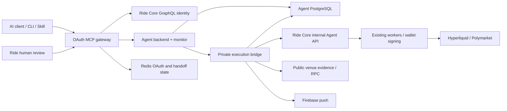

# Rider 系统架构

核对日期 2026-10-29，源码以远程 `a4402eb` 为准（本地工作树 `f20f87e`，差异已核对）。这里描述代码实现；当前线上角色绑定/版本见 [status](status.md)。

## 组件与边界

| 进程 | 入口和默认端口 | 信任职责 |
|---|---|---|
| Gateway | `src/server.ts`, 3333 | OAuth issuer/resource、MCP、CLI API、浏览器/原生 human 路由；不签名 |
| Backend | `src/backend.ts` → `agent/backend.ts`, 3344 | Core identity 校验、每用户状态、业务状态机、监控/通知调度 |
| Bridge | `src/bridge.ts` → `agent/core_bridge.ts`, 3355 | S2S token、源/账户证据、Core 操作翻译、stable outbox 与 prediction 元数据 |
| 私有 Core/worker | 本仓不包含 | 最终用户/账户 ownership、控制平面、钱包密钥与交易执行 |

`src/start.ts` 用 `RIDE_SERVICE_ENTRYPOINT` 动态选择进程；Railway仓库配置直启 `dist/<entry>.js`；当前平台override为`npm start`，所以角色依赖平台process env。selector在角色的dotenv加载前读取，单改`.env`中的entrypoint不会切换启动角色。backend→bridge 使用 `RIDE_AGENT_EXECUTOR_TOKEN`，bridge→Core 使用独立 `RIDE_AGENT_CORE_SERVICE_TOKEN`，不能共用或给客户端。

## 用户旅程和数据流

1. 安装器为支持的 AI 客户端配置生产 MCP 和 Skill。Codex native HTTP OAuth 与 CLI 的本地 OAuth session 相互独立；Claude/Cursor 使用 CLI stdio adapter。CLI session 由 `src/cli/session.ts` 放在用户私有配置目录。
2. OAuth PKCE 登录经 Privy 获取身份，再向 Core GraphQL 交换/校验 Ride JWT。Redis 持久化 OAuth client/code/access/refresh token 以及浏览器 human handoff；loopback 开发可用内存 store。
3. `get_ride_guide` 动态返回工作流；schemas/tool metadata 在 `contracts.ts`、`mcp.ts`。实际 read-only tool 集合依据代码，旧文档中的数量可能落后。
4. 账户读同时区分 Agent 投资组合与已有 Ride App 跟单 (`account_reads.ts`)；Agent 空列表不说明 App 无持仓。候选发现、风险选择、精确行情窗口依次生成不可变 preview。
5. preview 编辑创建新 plan；`start_copy`/update/stop/close 等写工具生成过期时间、owner/revision、hash 都冻结的 proposal。OAuth trade scope 不直接执行。
6. 人类确认经浏览器 Privy +加密 HttpOnly cookie 或 native Core JWT，验证原 proposal。预算、资产、market、杠杆、期限均有边界的 delegation 也是独立人类授权。
7. 后台 runner 在用户不在线时读取 source/follower 证据、风控、构造 intent/outbox、经 Core 提交与对账。超时/未知响应保留 execution ID；只有可靠证据才能推进状态。
8. 实际 fills、fees、funding、external flows 进入 owned ledger 和不可变收益/报告快照。Inbox updates 持久化，bridge 调 FCM；推送 provider accepted 与真机收到分开。

## 状态存储与并发

`repository.ts` 的 `ride_agent_state(user_id,state JSONB,updated_at)` 保存 preferences、selection、plans、portfolios、proposals、delegation、updates、checkpoints、performance、notification preferences 等。迁移由 backend 启动创建。业务迁移在 `SELECT ... FOR UPDATE` 用户行事务中完成；token 所属用户作为边界，cursor 用独立签名 key 绑定用户。

bridge 以 `ride_agent_core_outbox` 保存 execution ID、fingerprint、payload、response；`prediction.ts` 创建 prediction 辅助表并负责 opaque receipt/token/outcome metadata。Core 自己的 ownership 和交易表位于另一仓，Agent 数据库不是完整交易真相。

一个 Agent DB 目前运维上只启一个 monitor。行锁可以序列化用户状态，但尚无跨进程 scheduler leases；同时 monitor 的外部证据观察可能重叠。20 秒 PostgreSQL statement deadline、25 秒 driver query deadline及失败连接销毁限制阻塞；SIGTERM 立即关闭 pre-callback readers。没有信号的硬杀仍依赖网络断联检测，见 [10/28 修复记录](repository-clientwrite-shutdown-2026-10-28.md)。

## 证据、跟单和账本

- `source-feed.ts` 独立每 5 秒采样感兴趣 public source，5 秒 fresh 上限、失败 cooldown；不接受 follower 初始化或签名回调。
- `venue-reads.ts`经`venue-read-budget.ts`为同进程所有实例与两个Hyperliquid host共用60秒滚动加权预算（默认1000，上限1200）；account/source有lane与owner公平调度，同请求single-flight、429 cooldown、最长12秒完整证据deadline。`venue-read-cost.ts`验证method与响应rows，未知row附加费用需独占保留可用容量，真实响应按全量收费、超支记录debt。账户证据不跨已完成请求复用；该预算不跨pod/fleet。
- Fixed 跟单需要受支持 market scope、完整 source snapshot、覆盖窗口内的 fill evidence、确定排序；不完整证据拒绝增加风险。
- 未入场的 suppressed shadow 只有满足完整负证据且没有任何 follower intent/lot/allocation/receipt 才可移除。风控正常阻挡新目标不会强行提交 Fixed cursor。
- Perps 可能净额抵消，但 owned sleeve 仍按 gross 归属；prediction outcome tokens 分开，不能混合为同标的净仓。
- 不完整收益是 `null`；外部充值/提现不能计为交易收益。历史 source fills 计数不等于 follower executable order 数。

## UI 与工作流

`public/agent-view.js`、`agent-host.js`、CSS 由 `scripts-build-ui.mjs` 内嵌成 `agent.html`；fund/confirm 页面还维护独立 host/view。`mcp.ts` 发布 `ui://ride/agent-v10-compact-confirmation.html` 及旧 aliases；确认页当前状态与历史已完成结果分开展示。

MCP Apps 卡片通过 host protocol 调工具；无卡片宿主使用 Skill/CLI contracts。资金卡片在可信 Ride frame 内恢复 session/签名，不自动弹 popup；兼容 standalone 链接的具体行为看 `docs/confirmation-cards.md`。AI 对话、实时 guide、网页文案和权限策略都必须保持一致，guide 更新本身不增加授权。

## 外部服务

| 服务/API | 作用 | 入口 |
|---|---|---|
| Ride Core GraphQL | Login exchange、身份、App owned account reads | `auth_exchange.ts`, `account_reads.ts`, `agent/backend.ts` |
| Ride Core internal Agent API | 账户归属、下单/对账/释放等受控动作 | `agent/core_bridge.ts` |
| Privy + browser SDK CDN | Google/Apple 等登录/钱包恢复 | `oauth.ts`, `agent/human.ts`, `server.ts` |
| Hyperliquid mainnet/testnet `/info` | 公共源/owned账户证据 | `core_bridge.ts`, `deposits.ts`, `venue-reads.ts` |
| Polymarket Data API/CLOB/Bridge | 来源/订单簿/资金准备/chain receipt 证据 | `prediction*.ts`, `deposits.ts` |
| Polygon/Arbitrum JSON-RPC（含`account_balances.ts` PublicNode fallback） | prediction/USDC 转账及资金状态证据 | `prediction.ts`, `deposits.ts` |
| PostgreSQL/Redis | durable Agent/OAuth state | `repository.ts`, `oauth.ts`, `human_handoffs.ts` |
| Firebase FCM/OAuth token | 后台推送 | `firebase.ts`, `core_bridge.ts` |
| GitHub/npm | CI、安装器分发、trusted package publishing | `.github/workflows`, `src/cli` |

具体账号、变量、密钥所有者见 [infra](infra.md)。生产服务是否均连通与当前 provider 配额：TBD – confirm。
